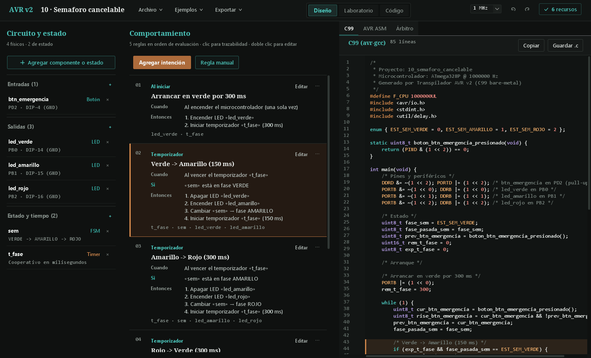
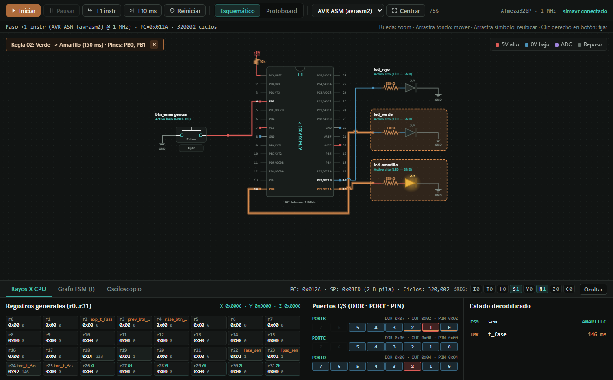
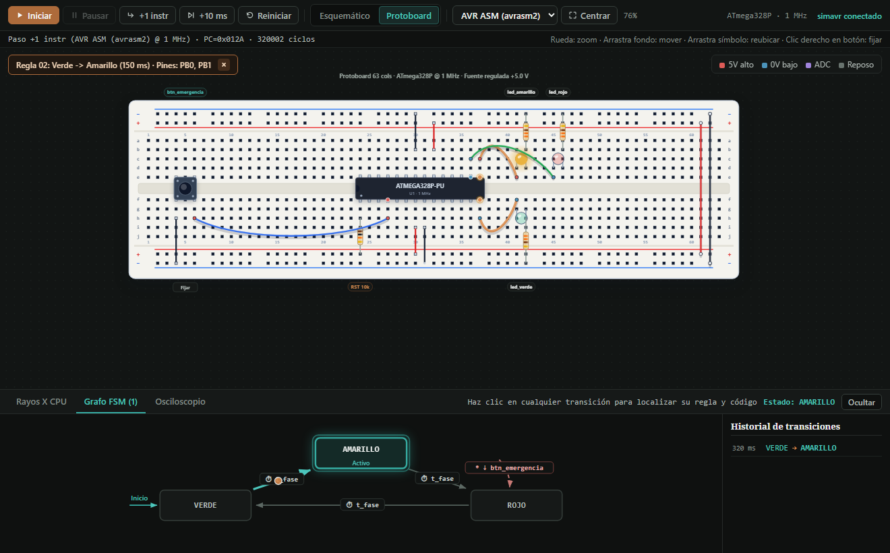
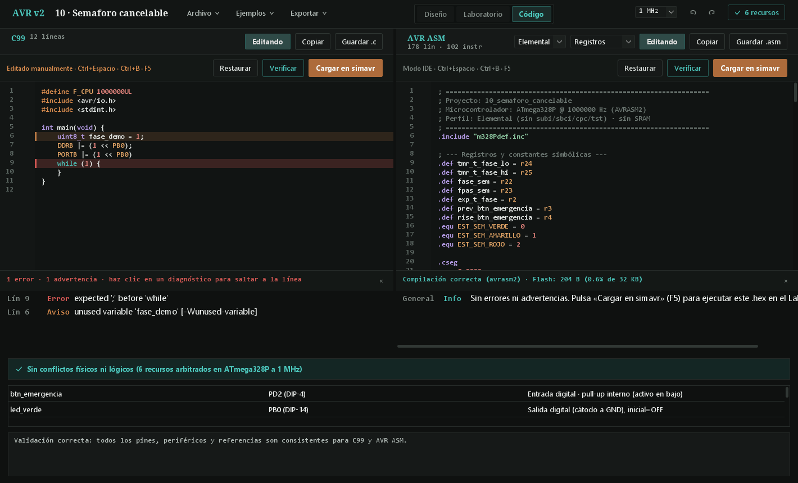
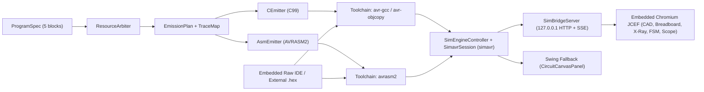

# AVR Transpiler — Didactic Studio & IDE for ATmega328P (v1)

This transpiler is a didactic engineering tool for the **ATmega328P** microcontroller (1 MHz, 8 MHz, and 16 MHz). It lets users specify a circuit and its physical rules without writing code, statically validate hardware resources, generate readable **C99** and **AVR ASM** code with verified behavioral parity, simulate the real `.hex` binary on **`simavr`** with live CPU and FSM inspection, or switch to the built-in **IDE** to edit raw code with autocomplete and verify it immediately.



---

## Studio Screenshots

<table>
  <tr>
    <td width="50%">
      <strong>Lab · CAD Schematic &amp; CPU X-Ray Inspector</strong><br/>
      
    </td>
    <td width="50%">
      <strong>Physical Breadboard &amp; Live Animated FSM Graph</strong><br/>
      
    </td>
  </tr>
  <tr>
    <td colspan="2">
      <strong>Code Mode · Built-in C99 &amp; AVR ASM IDE with clickable diagnostics and real Flash usage</strong><br/>
      
    </td>
  </tr>
</table>

---

## Core Capabilities (v1)

### 1. Declarative 5-Block Model & Resource Arbiter
The entire reactive domain of the ATmega328P is composed from five closed primitives (`dev.transpilador.v2.model`):
- **Hardware (`Hardware`):** selectable clock (`1 MHz`, `8 MHz`, `16 MHz`), pushbuttons (`GND` with internal pull-up or `VCC` with external pull-down), LEDs (`GND`/`VCC`), **CD4511** BCD 7-segment displays (4 consecutive pins), analog inputs **`ADC0..ADC5`**, **8-bit Fast PWM** outputs (`OC0A/B`, `OC1A/B`, `OC2A/B`), and **`UART0`** (`2400..115200 bps` 8N1 in `TX_ONLY`, `RX_ONLY`, `FULL_DUPLEX`, and `HALF_DUPLEX` with true turnaround switching).
- **State (`State`):** `U8` variables/counters (`WRAP` circular or `CLAMP` saturated), finite-state machines (`PhaseGroup`), and cooperative 16-bit millisecond timers (`1..65000 ms`, without reserving `Timer0`).
- **Expressions (`Expr`):** unified `U8`/`U10` values (constants, variables, single-sample 8/10-bit ADC reads, UART RX byte, integer scaling) and boolean predicates (`AND`, `OR`, `XOR`, `NOT`, comparisons, range checks, modulo, FSM phase, active timer).
- **Effects (`Effect`):** LED control, 1- or 2-digit BCD writes (statically bounded to `0..9` / `0..99`), Fast PWM duty updates, UART text/byte transmission, range-checked variable mutations, FSM phase transitions, and timer control.
- **Rules (`Rule`):** `When [event] · If [condition] -> [effects] (Else -> [effects])`, supported by **10 guided intentions** (`PedagogicalPatterns`) and **15 reference benchmark projects** (`BenchmarkCatalog`).
- **Resource Arbiter (`ResourceArbiter`):** statically blocks physical pin collisions, PWM timer conflicts, value range overflows, case-insensitive duplicate symbols, or dangling references before any code is emitted.

### 2. Dual Human-Like Code Generation in Parity (C99 + AVR ASM)

The goal of assembly and C code generation is not to produce machine-like output after compiler optimization passes; for this reason, instead of building a full optimizing IR, the project uses a template-based emitter with full traceability across the entire domain.

- **C99 (`CEmitter`):** clean bare-metal code (`<avr/io.h>`, `<stdint.h>`, `<util/delay.h>`) compiled with `avr-gcc -mmcu=atmega328p -Os -std=c99 -Wall -Wextra -Werror`.
- **AVR ASM (`AsmEmitter`):** `AVRASM2` assembly with two instruction profiles (**Elementary** course subset without `subi`/`sbci`/`cpc`/`tst`, and **Standard** full ATmega328P set) and two storage modes (**Registers-first** or **SRAM `.dseg`**).
- **4-Way Interactive Traceability:** clicking any rule, C99/ASM line, or FSM transition arrow simultaneously highlights the rule, the corresponding C99 and AVR ASM blocks, and the physical pins, wires, and components involved.
- **Didactic AVRASM2 Tooltips (`AvrInstructionCatalog`):** hovering over any instruction (`sbic`, `cpi`, `rjmp`, `lpm`, etc.) displays a contextual explanation using the line's actual operands, ATmega328P clock cycles, and affected `SREG` flags.

### 3. Real Binary Simulation on `simavr` (Embedded Chromium + Swing Fallback)
- **3 Synchronized Workspaces (`Diseño | Laboratorio | Código`):** Lab mode gives full width to the live simulator alongside a docked panel (`Reglas | C99 | AVR ASM`) for simultaneous 4-way traceability.
- **Two Interactive Circuit Views:** a technical CAD schematic with Manhattan orthogonal routing (bridge hops on crossings, live hover logic probes, draggable symbols) and a 63-column physical breadboard with color-banded resistors, realistically tinted LEDs, a rotary potentiometer, and CD4511 + 7-segment display.
- **CPU "X-Ray" Inspector & Single-Instruction Stepping (`+1 instr`):** reads live state from `simavr` and ELF `.symtab` symbols to display all 32 registers `r0..r31` (with symbolic aliases and change flash), `X/Y/Z` pointers, `SREG` flags (`I T H S V N Z C`), `PC`, `SP` with stack depth, `DDR/PORT/PIN` bit states, and decoded variables, FSM phases, and timers.
- **Real-Time FSM Graph:** automatically renders states and transitions (including global `*` interrupt/reset edges), highlights the active state in both **C99 and AVR ASM**, animates transitions live, and links each arrow back to its rule and code.
- **Oscilloscope / Logic Analyzer & UART Terminal:** digital, ADC, BCD, and real VCD-measured PWM frequency traces with draggable `A/B` measurement cursors (`Δt` and frequency) plus an interactive `USART0` console.

### 4. Opt-In Embedded IDE & External `.hex` Loading
- Toggle **`Editar`** in either the **C99** or **AVR ASM** viewer to unlock raw editing with live syntax highlighting, auto-indentation, local `Ctrl+Z`/`Ctrl+Y` undo/redo, and protection against model refreshes (with a **`Restaurar`** button to return to transpiled code).
- **Offline ATmega328P Autocomplete (`Ctrl+Space` or automatic after 2 characters):** AVR mnemonics with cycle counts, AVRASM2 directives, `r0..r31` registers, `PORT/DDR/PIN/ADC/PWM/UART` peripherals, and live symbols parsed from the active buffer.
- **Real Verification (`Ctrl+B`) & Direct `simavr` Loading (`F5`):** compiles/assembles with `avr-gcc` or `avrasm2`, highlights inline errors and warnings with a clickable diagnostics console, reports exact Flash usage (bytes and % of 32 KB), and loads the binary directly into the live lab.
- **External `.hex` Loading:** validate and run any externally compiled Intel HEX firmware against the current lab circuit via **`Archivo -> Cargar firmware .hex externo en simavr…`**.

---

## Architecture Overview



---

## Automated Verification & Test Suite

The full regression and parity suite runs via `build.ps1 package` (or `mvn package`) and covers **73 automated tests across 13 suites**:

| Coverage Area | Details |
| --- | --- |
| **Arbiter & Model** | `ArbiterTest`, `PersistenceAndPatternsTest` (strict `.avr2.json` parsing, value bounds, pin/timer collisions, guided patterns) |
| **Combinatorial Matrix & Real Builds** | `DomainMatrixTest`: **1,820 specifications** evaluated (1,628 valid + 192 expected rejections) and **880 real builds** (`avr-gcc` + `avrasm2`) |
| **Triple Parity on `simavr`** | `SimavrParityTest`, `MultiClockParityTest`, `TripleParityCoverageTest` (Reference Oracle vs. C99 vs. AVR ASM at 1, 8, and 16 MHz) |
| **Emitted Code Quality** | `HumanLikeCodeTest` (Elementary instruction subset compliance and KISS readability invariants) |
| **X-Ray, Traceability & FSM** | `XRayTraceabilityFsmTest`, `SimBridgeServerTest` (live CPU/ELF telemetry in C99 & ASM, 100% ASM tooltip coverage, 4-way synchronization) |
| **Embedded IDE & Regressions** | `EmbeddedIdeTest`, `StudioHeadlessTest`, `BugFixesRegressionTest`, `SecondPassRegressionTest` |

---

## Environment Requirements

- **Java:** JDK 21+ (tested on **Azul Zulu 25**).
- **Maven:** 3.9+ (`build.ps1` runs Maven in offline mode `-o` using local development paths; on a fresh machine, run `mvn package` online once to download dependencies).
- **AVR Toolchain (required for real builds, `.hex` export, and the full test suite):**
  - `avr-gcc` and `avr-objcopy` (Atmel Studio 7.0 or compatible AVR-GCC toolchain; overridable via `-Davr.gcc=...` and `-Davr.objcopy=...`).
  - `avrasm2.exe` and include directory containing `m328Pdef.inc` (auto-detected from Atmel Studio 7.0 or Proteus 8; overridable via `-Davr.avrasm2=...` and `-Davr.includes=...`).
- **Binary Simulation (`simavr`):**
  - Linux binary `local-resources/simavr/firmware-runner` invoked through **WSL** (`Ubuntu-24.04` by default; source in `native/simavr/firmware_runner.c`, overridable via `-Dsimavr.runner=...` and `-Dsimavr.wsl.distribution=...`).
- **Embedded Chromium (JCEF):**
  - The GUI launches **Chromium 152 (`jcefmaven`)** by default and stores native binaries outside the JAR in `local-resources/jcef-bundle/` (requires internet access only on first launch if the bundle is not yet present).
  - Pass `-Dtranspilador.jcef.enabled=false` to run purely with the Swing circuit fallback without Chromium.

---

## Build & Run

### Build and run all tests

```powershell
# Standard Maven build (with internet access on first run)
mvn package

# Or using the local offline development script
powershell -ExecutionPolicy Bypass -File build.ps1 package
```

### Launch the Desktop GUI

On Windows, run `INICIAR_ESTUDIO_V2.cmd` directly, or start the packaged uber-JAR manually:

```powershell
java -Xmx512m --enable-native-access=ALL-UNNAMED `
  --add-opens=java.desktop/java.awt.peer=ALL-UNNAMED `
  --add-opens=java.desktop/sun.awt=ALL-UNNAMED `
  -jar target\transpilador-v2.jar --gui
```

### Command-Line Interface (CLI)

```powershell
# List all 15 built-in benchmark examples
java -jar target\transpilador-v2.jar --list-examples

# Transpile a .avr2.json project to C99
java -jar target\transpilador-v2.jar project.avr2.json output.c

# Transpile to AVR ASM (optional standard profile and SRAM .dseg storage)
java -jar target\transpilador-v2.jar project.avr2.json output.asm [--asm-standard] [--asm-sram]
```

---

## Repository Layout

| Path | Description |
| --- | --- |
| `src/main/java/dev/transpilador/v2/model` | The 5 orthogonal primitives (`Hardware`, `State`, `Expr`, `Effect`, `Rule`) and `ProgramSpec` |
| `src/main/java/dev/transpilador/v2/arbiter` | `ResourceArbiter`: static validation of pins, PWM timers, value bounds, and symbols |
| `src/main/java/dev/transpilador/v2/emit` | `EmissionPlan`, `TraceMap`, `CEmitter`, `AsmEmitter`, and `AvrInstructionCatalog` |
| `src/main/java/dev/transpilador/v2/sim` | `Toolchain`, `SimavrSession`, `ElfSymbolReader`, `SimEngineController`, and `ReferenceOracle` |
| `src/main/java/dev/transpilador/v2/sim/web` | `SimBridgeServer`: local `127.0.0.1` HTTP + SSE bridge |
| `src/main/java/dev/transpilador/v2/patterns` | `BenchmarkCatalog` (15 examples) and `PedagogicalPatterns` (10 guided intentions) |
| `src/main/java/dev/transpilador/v2/persistence` | `ProjectJson`: strict zero-dependency `.avr2.json` serializer/parser |
| `src/main/java/dev/transpilador/v2/ui` | Swing/FlatLaf studio (`StudioTheme`, `StudioPanel`, `CodeViewerPane`, `AvrCodeCompleter`, dialogs), JCEF host, and Swing fallback |
| `src/main/resources/sim-web` | Lab web frontend (`index.html`, `styles.css`, `app.js`, `schematic.js`, `breadboard.js`, `xray.js`, `fsm.js`, `scope.js`) |
| `native/simavr/firmware_runner.c` | Native `simavr` runner (`STATE`, `STEP`, `REGS`, `MEM`, `PWM`, `UART`, `VCD` protocol) |
| `src/test/java/dev/transpilador/v2` | All 13 automated test suites (73 tests) |
| `docs/screenshots` | Rendered studio screenshots for documentation |

---

## v1 Scope & Future Horizon

This **v1** completes the end-to-end loop of declarative design, static hardware arbitration, dual C99/AVR ASM parity emission, real binary simulation with CPU X-Ray / FSM / Oscilloscope, and an integrated IDE for the ATmega328P. An open direction for a future version is a user-extensible component and peripheral engine that allows introducing new behaviors without modifying the transpiler source code.
